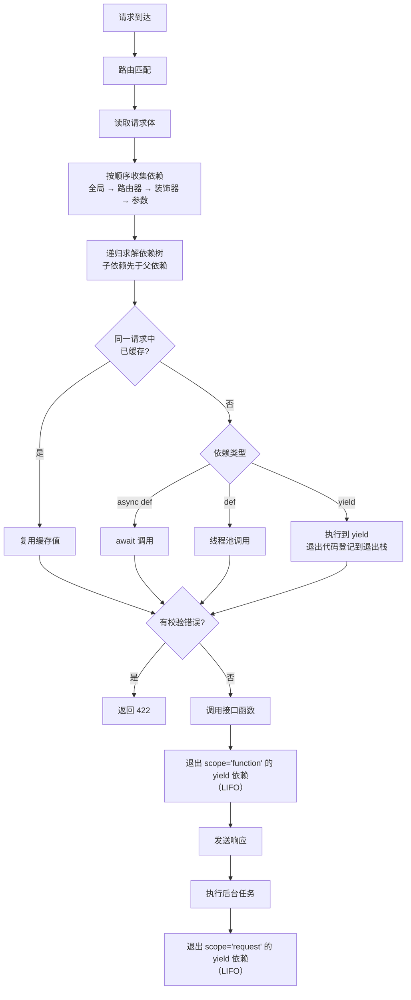

# 12.7 依赖注入

前面几节我们已经能用路径参数、查询参数、请求体、Header/Cookie 拿到请求数据，用 `response_model` 控制响应，用 `HTTPException` 返回错误。但当接口数量一多，你会发现大量代码在**重复**：每个列表接口都要写 `skip`/`limit`，每个需要登录的接口都要解析 token、查用户，每个操作数据库的接口都要"打开会话→用完关闭"。FastAPI 用**依赖注入（Dependency Injection，DI）**系统解决这个问题：把这些公共逻辑写成独立的"依赖"，由框架在处理请求时自动调用、自动传参、自动清理。依赖注入是 FastAPI 最核心的设计，后面的安全认证（12.8）、数据库会话（12.9）、测试替身（12.13）都建立在它之上。

> 本节代码基于 FastAPI 0.143 / Pydantic 2.14 / Starlette 1.8 / Python 3.14 实际运行验证。

## 1. 什么是依赖注入

"依赖"指的是：**一个接口函数为了完成工作而需要的东西**——分页参数、数据库连接、当前登录用户、配置对象等。

- **不用依赖注入**：接口函数自己去"拿"这些东西（自己解析参数、自己建连接、自己校验 token）。
- **用依赖注入**：接口函数只**声明**"我需要什么"，由 FastAPI 负责创建并"注入"进来。

先看没有依赖注入时的样子：

```python
from fastapi import FastAPI

app = FastAPI()


@app.get("/items/")
async def read_items(q: str | None = None, skip: int = 0, limit: int = 100):
    # 每个列表接口都重复这三个参数和相同的处理逻辑
    return {"q": q, "skip": skip, "limit": min(limit, 100)}


@app.get("/users/")
async def read_users(q: str | None = None, skip: int = 0, limit: int = 100):
    return {"q": q, "skip": skip, "limit": min(limit, 100)}
```

问题很明显：参数定义重复、校验逻辑（`min(limit, 100)`）重复，以后要改分页规则就得改 N 处。

依赖注入带来的好处：

| 好处 | 说明 |
|---|---|
| 复用 | 公共逻辑写一次，任意接口声明即可使用 |
| 解耦 | 接口函数只关心业务，不关心"东西从哪来" |
| 可组合 | 依赖可以再依赖别的依赖，形成依赖树 |
| 自动文档 | 依赖里声明的查询参数、Header 等会自动出现在 OpenAPI 文档中 |
| 自动清理 | 带 `yield` 的依赖可以在请求结束后自动释放资源 |
| 易测试 | 测试时可以用 `app.dependency_overrides` 把真实依赖替换成假的 |

典型应用场景：

- 公共查询参数（分页、排序、过滤）
- 数据库会话的获取与关闭
- 认证（解析 token → 当前用户）与授权（角色/权限检查）
- 读取配置、限流、记录审计日志
- 共享的客户端对象（HTTP 客户端、缓存客户端）

## 2. 第一个依赖：函数依赖

依赖本质上就是一个**可调用对象**（通常是函数），它的参数声明方式与路径操作函数完全一样：

```python
from typing import Annotated

from fastapi import Depends, FastAPI

app = FastAPI()


async def common_parameters(q: str | None = None, skip: int = 0, limit: int = 100):
    """公共分页参数：FastAPI 会像解析接口参数一样解析这里的参数"""
    return {"q": q, "skip": skip, "limit": min(limit, 100)}


@app.get("/items/")
async def read_items(commons: Annotated[dict, Depends(common_parameters)]):
    return {"from": "items", **commons}


@app.get("/users/")
async def read_users(commons: Annotated[dict, Depends(common_parameters)]):
    return {"from": "users", **commons}
```

运行：

```bash
fastapi dev main.py
```

请求与输出：

```bash
curl "http://127.0.0.1:8000/items/?q=phone&limit=500"
# {"from":"items","q":"phone","skip":0,"limit":100}

curl "http://127.0.0.1:8000/users/?skip=20"
# {"from":"users","q":null,"skip":20,"limit":100}

curl "http://127.0.0.1:8000/items/?skip=abc"
# 422 {"detail":[{"type":"int_parsing","loc":["query","skip"],"msg":"Input should be a valid integer, unable to parse string as an integer","input":"abc"}]}
```

处理一个请求时 FastAPI 做了这些事：

1. 发现参数 `commons` 是 `Depends(common_parameters)`；
2. 从请求中解析 `common_parameters` 需要的参数 `q`、`skip`、`limit`（包括类型转换和校验）；
3. 调用 `common_parameters(q=..., skip=..., limit=...)`；
4. 把返回值赋给 `commons`，再调用 `read_items`。

> ⚠️ `Depends()` 里传的是**函数本身**（`common_parameters`），不是调用结果（`common_parameters()`）。是否调用、什么时候调用、传什么参数，全部由 FastAPI 决定。

> 💡 打开 `/docs` 可以看到 `/items/` 和 `/users/` 都自动带上了 `q`、`skip`、`limit` 三个查询参数——依赖里的参数会被合并进接口的 OpenAPI 定义。

依赖函数里能声明的东西和接口函数**完全一样**：路径参数、查询参数、`Header`、`Cookie`、请求体、`Request` 对象，甚至其他依赖。可以简单理解为"依赖就是一个没有装饰器的路径操作函数"。

## 3. 使用 Annotated 定义依赖别名

`Annotated[dict, Depends(common_parameters)]` 写起来较长。由于 `Annotated` 只是一个普通的类型对象，可以把它赋值给一个变量，当作"类型别名"复用：

```python
from typing import Annotated

from fastapi import Depends, FastAPI

app = FastAPI()


async def common_parameters(q: str | None = None, skip: int = 0, limit: int = 100):
    return {"q": q, "skip": skip, "limit": limit}


# 定义一次，到处复用
CommonsDep = Annotated[dict, Depends(common_parameters)]


@app.get("/items/")
async def read_items(commons: CommonsDep):
    return commons


@app.get("/orders/")
async def read_orders(commons: CommonsDep):
    return commons
```

这是 FastAPI 官方推荐的写法，在真实项目中非常常见，例如：

```python
SessionDep = Annotated[Session, Depends(get_session)]
CurrentUser = Annotated[User, Depends(get_current_user)]
SettingsDep = Annotated[Settings, Depends(get_settings)]
```

> 💡 别名同时保留了类型信息（`dict`、`Session`、`User`），编辑器可以正常补全和类型检查。

旧写法 `commons: dict = Depends(common_parameters)`（把 `Depends` 当默认值）仍然能用，但它有两个缺点：函数被直接调用时默认值是一个 `Depends` 对象而非真实值；默认值参数必须排在后面，限制参数顺序。新代码统一用 `Annotated`。

## 4. 类作为依赖

用 `dict` 作为依赖返回值有个问题：编辑器不知道里面有哪些键，`commons["skp"]` 这种拼写错误要到运行时才暴露。

`Depends` 接收的是**任意可调用对象**，而 Python 的类本身就是可调用的（调用类 = 创建实例）。FastAPI 会分析类的 `__init__` 参数，并把它们当作请求参数解析：

```python
from typing import Annotated

from fastapi import Depends, FastAPI

app = FastAPI()

fake_items_db = [{"name": "Foo"}, {"name": "Bar"}, {"name": "Baz"}]


class CommonQueryParams:
    def __init__(self, q: str | None = None, skip: int = 0, limit: int = 100):
        self.q = q
        self.skip = skip
        self.limit = limit


@app.get("/items/")
async def read_items(commons: Annotated[CommonQueryParams, Depends(CommonQueryParams)]):
    response = {}
    if commons.q:  # 有属性提示，拼写错误能被编辑器发现
        response["q"] = commons.q
    response["items"] = fake_items_db[commons.skip : commons.skip + commons.limit]
    return response
```

```bash
curl "http://127.0.0.1:8000/items/?skip=1&limit=1&q=hi"
# {"q":"hi","items":[{"name":"Bar"}]}
```

### 4.1 `Depends()` 简写

注意上面 `CommonQueryParams` 写了两次。当**类型注解和依赖是同一个类**时，可以省略 `Depends` 的参数，FastAPI 会直接使用类型注解里的类：

```python
# 完整写法
commons: Annotated[CommonQueryParams, Depends(CommonQueryParams)]

# 简写，效果完全相同
commons: Annotated[CommonQueryParams, Depends()]
```

### 4.2 用 dataclass 更简洁

手写 `__init__` 比较啰嗦，用 `dataclass` 自动生成 `__init__` 同样可以：

```python
from dataclasses import dataclass
from typing import Annotated

from fastapi import Depends, FastAPI, Query

app = FastAPI()


@dataclass
class Pagination:
    page: Annotated[int, Query(ge=1)] = 1
    size: Annotated[int, Query(ge=1, le=100)] = 20

    @property
    def offset(self) -> int:
        return (self.page - 1) * self.size


@app.get("/articles/")
async def list_articles(p: Annotated[Pagination, Depends()]):
    return {"page": p.page, "size": p.size, "offset": p.offset}
```

```bash
curl "http://127.0.0.1:8000/articles/?page=3&size=10"
# {"page":3,"size":10,"offset":20}

curl "http://127.0.0.1:8000/articles/?size=500"
# 422，loc 为 ["query","size"]，msg 为 "Input should be less than or equal to 100"
```

> 💡 对于"只是一组查询参数"的场景，也可以用 12.2 介绍的**查询参数模型**（`Annotated[Model, Query()]`）。两者的区别是：依赖类可以附带方法、可以再依赖其他依赖、可以混合 Header/Cookie 等多种来源；查询参数模型只负责查询参数，但可以用 `extra="forbid"` 禁止未知参数。

## 5. 子依赖与依赖树

依赖本身也可以声明依赖，形成任意深度的**依赖树**。FastAPI 会自动从叶子开始逐层求解：

```python
from typing import Annotated

from fastapi import Cookie, Depends, FastAPI

app = FastAPI()


def query_extractor(q: str | None = None):
    print("query_extractor 被调用")
    return q


def query_or_cookie_extractor(
    q: Annotated[str | None, Depends(query_extractor)],
    last_query: Annotated[str | None, Cookie()] = None,
):
    print("query_or_cookie_extractor 被调用")
    if not q:
        return last_query
    return q


@app.get("/items/")
async def read_query(query_or_default: Annotated[str | None, Depends(query_or_cookie_extractor)]):
    return {"q_or_cookie": query_or_default}
```

```bash
curl "http://127.0.0.1:8000/items/?q=hello"
# {"q_or_cookie":"hello"}

curl "http://127.0.0.1:8000/items/" --cookie "last_query=from-cookie"
# {"q_or_cookie":"from-cookie"}
```

依赖树：

```text
read_query
└── query_or_cookie_extractor      （还需要 Cookie: last_query）
    └── query_extractor            （需要查询参数 q）
```

控制台输出顺序总是"先子后父"：

```text
query_extractor 被调用
query_or_cookie_extractor 被调用
```

一个更贴近实战的依赖链（12.8 会完整实现）：

```text
get_current_active_user        检查用户是否被禁用
└── get_current_user           解码 token、查询用户
    ├── oauth2_scheme          从 Authorization 头中取出 token
    └── get_db                 获取数据库会话
```

每一层只做一件事，接口按需选择依赖哪一层：只需要"已登录"就依赖 `get_current_user`，需要"已登录且未禁用"就依赖 `get_current_active_user`。

## 6. 依赖缓存与 `use_cache=False`

在**同一个请求**中，如果同一个依赖被多处声明（比如接口和它的两个子依赖都依赖 `get_db`），FastAPI 默认**只调用一次**，之后直接复用第一次的返回值：

```python
from typing import Annotated

from fastapi import Depends, FastAPI

app = FastAPI()

call_count = {"value": 0}


def get_counter():
    call_count["value"] += 1
    print(f"get_counter 第 {call_count['value']} 次被调用")
    return call_count["value"]


def dep_a(c: Annotated[int, Depends(get_counter)]):
    return c


def dep_b(c: Annotated[int, Depends(get_counter)]):
    return c


@app.get("/cached")
def cached(
    a: Annotated[int, Depends(dep_a)],
    b: Annotated[int, Depends(dep_b)],
    c: Annotated[int, Depends(get_counter)],
):
    return {"a": a, "b": b, "c": c}


@app.get("/no-cache")
def no_cache(
    a: Annotated[int, Depends(get_counter, use_cache=False)],
    b: Annotated[int, Depends(get_counter, use_cache=False)],
):
    return {"a": a, "b": b}
```

```bash
curl http://127.0.0.1:8000/cached
# {"a":1,"b":1,"c":1}          get_counter 只被调用 1 次

curl http://127.0.0.1:8000/no-cache
# {"a":2,"b":3}                每次声明都重新调用
```

几个要点：

- 缓存的**范围是单个请求**，不同请求之间不共享。想跨请求缓存（如配置对象），用 `functools.lru_cache` 装饰依赖函数，或在 `lifespan` 中创建放到 `app.state`。
- 缓存的 key 是"依赖函数 + 安全 scopes"，所以同一个函数在同一请求里拿到的是同一个对象——这正是"一个请求共用一个数据库会话"能成立的原因。
- `use_cache=False` 适用于"每次都需要全新结果"的场景，例如生成随机数、记录调用次数。

```python
from functools import lru_cache


class Settings:
    def __init__(self):
        print("加载配置（只会打印一次）")
        self.app_name = "demo"


@lru_cache
def get_settings() -> Settings:
    return Settings()
```

## 7. 同步依赖与异步依赖

依赖可以是 `def` 也可以是 `async def`，可以任意混用，FastAPI 会正确处理：

| 依赖类型 | FastAPI 的处理方式 | 适合 |
|---|---|---|
| `async def` | 在事件循环中直接 `await` | 内部调用异步库（`httpx.AsyncClient`、异步数据库驱动） |
| `def` | 放到**线程池**中执行，不阻塞事件循环 | 内部调用同步阻塞库（同步 SQLAlchemy、`requests`） |
| `async def` + `yield` | 异步生成器，在事件循环中执行 | 异步资源的获取与释放 |
| `def` + `yield` | 同步生成器，前后两段代码均在线程池执行 | 同步资源的获取与释放 |

```python
import asyncio
import time
from typing import Annotated

from fastapi import Depends, FastAPI

app = FastAPI()


def sync_dep():
    time.sleep(0.1)  # 同步阻塞：没关系，它在线程池里运行
    return "sync"


async def async_dep(s: Annotated[str, Depends(sync_dep)]):
    await asyncio.sleep(0.1)  # 异步等待
    return f"async<-{s}"


@app.get("/mix")
async def mix(value: Annotated[str, Depends(async_dep)]):
    return {"value": value}
```

```bash
curl http://127.0.0.1:8000/mix
# {"value":"async<-sync"}
```

> ⚠️ 规则和路径操作函数一致：**`async def` 依赖里绝不能调用阻塞函数**（`time.sleep`、同步数据库查询、`requests.get`），否则会卡住整个事件循环。拿不准时就用 `def`。

## 8. 带 `yield` 的依赖

很多资源需要"用之前获取、用完之后释放"：数据库会话、文件句柄、锁、临时目录……带 `yield` 的依赖专门解决这个问题，写法和 `contextlib.contextmanager` 非常像：

- `yield` **之前**的代码：在接口函数执行前运行（获取资源）；
- `yield` 出去的值：注入给接口函数；
- `yield` **之后**的代码：在请求处理结束后运行（释放资源）。

### 8.1 基本用法：获取与释放资源

```python
from typing import Annotated

from fastapi import Depends, FastAPI

app = FastAPI()


class FakeSession:
    def __init__(self):
        print("打开数据库会话")
        self.closed = False

    def query(self):
        return [{"id": 1, "name": "Alice"}]

    def close(self):
        print("关闭数据库会话")
        self.closed = True


def get_db():
    db = FakeSession()
    try:
        yield db  # 注入给接口函数
    finally:
        db.close()  # 无论成功还是异常都会执行


SessionDep = Annotated[FakeSession, Depends(get_db)]


@app.get("/users/")
def list_users(db: SessionDep):
    print("执行接口函数")
    return db.query()
```

```bash
curl http://127.0.0.1:8000/users/
# [{"id":1,"name":"Alice"}]
```

控制台：

```text
打开数据库会话
执行接口函数
关闭数据库会话
```

> 💡 用 `try ... finally` 包住 `yield` 是标准写法，保证接口函数即使抛出异常，资源也一定会被释放。

### 8.2 多个 yield 依赖的进入与退出顺序

多个 `yield` 依赖按依赖树**先进后出（LIFO）**：先进入的最后退出，和嵌套的 `with` 语句一样：

```python
from typing import Annotated

from fastapi import Depends, FastAPI

app = FastAPI()


async def dep_a():
    print("A: 进入")
    yield "a"
    print("A: 退出")


async def dep_b(a: Annotated[str, Depends(dep_a)]):
    print("B: 进入")
    yield f"{a}+b"
    print("B: 退出")


async def dep_c(b: Annotated[str, Depends(dep_b)]):
    print("C: 进入")
    yield f"{b}+c"
    print("C: 退出")


@app.get("/chain")
async def chain(c: Annotated[str, Depends(dep_c)]):
    print("接口函数执行")
    return {"value": c}
```

```bash
curl http://127.0.0.1:8000/chain
# {"value":"a+b+c"}
```

控制台：

```text
A: 进入
B: 进入
C: 进入
接口函数执行
C: 退出
B: 退出
A: 退出
```

这保证了"外层资源在内层资源释放之后才释放"，例如事务（`dep_c`）一定在数据库连接（`dep_a`）关闭之前提交。

### 8.3 yield 依赖中的异常处理

接口函数（或更内层的依赖）抛出的异常，会在 `yield` 那一行**重新抛进**依赖里，因此可以用 `try/except` 捕获，例如出错时回滚事务：

```python
from typing import Annotated

from fastapi import Depends, FastAPI, HTTPException

app = FastAPI()


class FakeTransaction:
    def commit(self):
        print("提交事务")

    def rollback(self):
        print("回滚事务")


def get_tx():
    tx = FakeTransaction()
    try:
        yield tx
        tx.commit()  # 没有异常才会执行到这里
    except Exception:
        tx.rollback()
        raise  # ⚠️ 必须重新抛出
    finally:
        print("释放连接")


@app.post("/transfer/{amount}")
def transfer(amount: int, tx: Annotated[FakeTransaction, Depends(get_tx)]):
    if amount <= 0:
        raise HTTPException(status_code=400, detail="金额必须为正数")
    return {"transferred": amount}
```

```bash
curl -X POST http://127.0.0.1:8000/transfer/100
# {"transferred":100}
# 控制台：提交事务 → 释放连接

curl -X POST http://127.0.0.1:8000/transfer/-1
# 400 {"detail":"金额必须为正数"}
# 控制台：回滚事务 → 释放连接
```

注意第二个请求：**`HTTPException` 也会抛进依赖里**，所以依赖能看到它、回滚事务；重新 `raise` 之后，FastAPI 再把它转换成 400 响应。

#### 吞掉异常会怎样？

如果 `except` 捕获了异常却**没有重新抛出**：

```python
def swallow():
    try:
        yield 1
    except ValueError:
        print("吞掉了异常")  # 没有 raise


@app.get("/swallow")
def swallow_endpoint(x: Annotated[int, Depends(swallow)]):
    raise ValueError("boom")
```

此时接口函数没有返回响应，异常又被吞掉了，FastAPI 无法得到任何响应，只能抛出：

```text
fastapi.exceptions.FastAPIError: Response not awaited. There's a high chance that the
application code is raising an exception and a dependency with yield has a block with
a bare except, or a block with except Exception, and is not raising the exception again.
```

客户端收到 `500 Internal Server Error`，而且原始的 `ValueError` 信息丢失，非常难排查。

> ⚠️ **铁律：在 yield 依赖中 `except` 了异常，就一定要 `raise`**（原样重新抛出，或者转换成另一个异常抛出）。只做清理工作的话用 `finally`，不要用 `except`。

### 8.4 在 yield 依赖中转换异常

依赖可以把底层异常"翻译"成 HTTP 错误，让接口函数只写业务逻辑：

```python
from typing import Annotated

from fastapi import Depends, FastAPI, HTTPException

app = FastAPI()

data = {"plumbus": {"owner": "Morty"}}


class OwnerError(Exception):
    pass


def get_username():
    try:
        yield "Rick"
    except OwnerError as e:
        # 把业务异常转换成 HTTP 400
        raise HTTPException(status_code=400, detail=f"Owner error: {e}")


@app.get("/items/{item_id}")
def get_item(item_id: str, username: Annotated[str, Depends(get_username)]):
    if item_id not in data:
        raise HTTPException(status_code=404, detail="Item not found")
    item = data[item_id]
    if item["owner"] != username:
        raise OwnerError(username)
    return item
```

```bash
curl http://127.0.0.1:8000/items/plumbus
# 400 {"detail":"Owner error: Rick"}

curl http://127.0.0.1:8000/items/portal-gun
# 404 {"detail":"Item not found"}
```

> 💡 更通用的"异常→响应"转换应该用 12.6 介绍的 `@app.exception_handler`。yield 依赖里的转换适合与资源强相关的场景（例如把数据库驱动的 `IntegrityError` 转成 409）。

### 8.5 退出时机与 `scope` 参数

`yield` 之后的代码"什么时候"运行？在当前版本中，答案取决于 `Depends` 的 `scope` 参数：

| `scope` | `yield` 之前 | `yield` 之后 | 默认用于 |
|---|---|---|---|
| `"request"` | 接口函数执行前 | **响应发送给客户端之后** | 所有 yield 依赖的默认值 |
| `"function"` | 接口函数执行前 | 接口函数返回之后、**响应发送之前** | 需要显式指定 |

用一个流式响应就能看清区别（流式响应是"接口函数已返回，但响应体还在一块块发送"的典型场景）：

```python
from typing import Annotated

from fastapi import Depends, FastAPI
from fastapi.responses import StreamingResponse

app = FastAPI()


def dep_request():
    print("request 依赖: 进入")
    yield "R"
    print("request 依赖: 退出")


def dep_function():
    print("function 依赖: 进入")
    yield "F"
    print("function 依赖: 退出")


def body_generator():
    print("开始发送响应体")
    yield "hello "
    yield "world"
    print("响应体发送完毕")


@app.get("/stream")
def stream(
    r: Annotated[str, Depends(dep_request)],
    f: Annotated[str, Depends(dep_function, scope="function")],
):
    print("接口函数执行")
    return StreamingResponse(body_generator())
```

```bash
curl http://127.0.0.1:8000/stream
# hello world
```

控制台：

```text
request 依赖: 进入
function 依赖: 进入
接口函数执行
function 依赖: 退出        ← 接口函数一返回就退出
开始发送响应体
响应体发送完毕
request 依赖: 退出         ← 响应完全发送后才退出
```

如何选择：

- **默认的 `"request"`**：资源在整个响应期间都可用。例如流式响应的生成器里还要查询数据库，会话就必须等响应发完再关。
- **`"function"`**：希望尽早释放资源，或者希望 `yield` 之后的代码**还能影响响应**。

第二点很关键。看下面这个在 `yield` 之后抛 `HTTPException` 的依赖：

```python
from fastapi import Depends, FastAPI, HTTPException

app = FastAPI()


def check_after():
    yield
    raise HTTPException(status_code=400, detail="事后检查失败")


@app.get("/after-request", dependencies=[Depends(check_after)])
def after_request():
    return {"ok": True}


@app.get("/after-function", dependencies=[Depends(check_after, scope="function")])
def after_function():
    return {"ok": True}
```

- `/after-function`：返回 `400 {"detail":"事后检查失败"}`——此时响应还没发送，异常可以被转换成响应。
- `/after-request`：客户端已经收到了 `200 {"ok":true}`，异常发生在响应之后，只会在服务端产生一条错误日志（`RuntimeError: Caught handled exception, but response already started.`），客户端毫不知情。

> ⚠️ 因此：**默认 scope 下，不要指望在 `yield` 之后通过抛 `HTTPException` 修改响应**。`yield` 之后应该只做清理工作。

另一个限制：`"request"` 作用域的依赖**不能**依赖 `"function"` 作用域的依赖（外层资源的生命周期不能比内层更长），否则在注册路由时就会报错：

```text
fastapi.exceptions.DependencyScopeError: The dependency "outer" has a scope of "request",
it cannot depend on dependencies with scope "function".
```

> 💡 背景知识：FastAPI 早期版本（0.106 之前）中 yield 依赖的退出代码在响应发送之后运行，0.106 改为在响应之前运行，之后又引入 `scope` 参数，让两种行为都能显式选择，并把默认值定为 `"request"`。网上旧教程对"退出时机"的描述可能不一致，以你所用版本的实际行为为准。

### 8.6 yield 依赖与 `with` 语句结合

`yield` 依赖里可以直接使用上下文管理器，这是封装第三方资源最简洁的写法：

```python
from typing import Annotated

import httpx
from fastapi import Depends, FastAPI

app = FastAPI()


async def get_http_client():
    async with httpx.AsyncClient(timeout=5) as client:
        yield client  # 请求结束后 async with 自动关闭客户端


@app.get("/proxy")
async def proxy(client: Annotated[httpx.AsyncClient, Depends(get_http_client)]):
    return {"client_closed": client.is_closed}
```

> 💡 每个请求新建一个 `httpx.AsyncClient` 开销不小，生产中更常见的做法是在 `lifespan` 中创建一个全局客户端（见 12.11），依赖只负责把它取出来。

## 9. 在路径装饰器中声明依赖

有些依赖**只需要执行，不需要返回值**，例如校验请求头、记录访问日志、限流。把它们写在接口参数里会让函数签名多出一堆用不到的参数（还会触发编辑器"未使用变量"的警告）。这时可以放到装饰器的 `dependencies` 参数中：

```python
from typing import Annotated

from fastapi import Depends, FastAPI, Header, HTTPException

app = FastAPI()


async def verify_token(x_token: Annotated[str, Header()]):
    if x_token != "fake-super-secret-token":
        raise HTTPException(status_code=400, detail="X-Token header invalid")


async def verify_key(x_key: Annotated[str, Header()]):
    if x_key != "fake-super-secret-key":
        raise HTTPException(status_code=400, detail="X-Key header invalid")
    return x_key  # 返回值会被忽略


@app.get("/items/", dependencies=[Depends(verify_token), Depends(verify_key)])
async def read_items():
    return [{"item": "Foo"}, {"item": "Bar"}]
```

```bash
curl http://127.0.0.1:8000/items/ \
  -H "X-Token: fake-super-secret-token" -H "X-Key: fake-super-secret-key"
# [{"item":"Foo"},{"item":"Bar"}]

curl http://127.0.0.1:8000/items/ -H "X-Token: wrong" -H "X-Key: fake-super-secret-key"
# 400 {"detail":"X-Token header invalid"}

curl http://127.0.0.1:8000/items/
# 422，提示 header 中缺少 x-token 和 x-key
```

这些依赖和普通依赖完全一样：会执行、能抛异常、能有子依赖、能用 `yield`、参数会出现在文档中，唯一区别是**返回值不会传给接口函数**。

## 10. 路由器级与全局依赖

依赖还可以挂在更高的层级上，对一批接口统一生效：

```python
from typing import Annotated

from fastapi import APIRouter, Depends, FastAPI, Header, HTTPException


async def log_request():
    print("全局依赖：记录请求")


async def verify_admin(x_role: Annotated[str, Header()]):
    if x_role != "admin":
        raise HTTPException(status_code=403, detail="Admins only")


# 1. 全局依赖：对应用的所有路由生效
app = FastAPI(dependencies=[Depends(log_request)])

# 2. 路由器级依赖：对该 router 下的所有路由生效
admin_router = APIRouter(prefix="/admin", dependencies=[Depends(verify_admin)])


@admin_router.get("/stats")
async def stats():
    return {"users": 42}


@app.get("/public")
async def public():
    return {"msg": "anyone can see"}


# 3. 也可以在 include_router 时追加依赖
app.include_router(admin_router)
```

```bash
curl http://127.0.0.1:8000/public
# {"msg":"anyone can see"}

curl http://127.0.0.1:8000/admin/stats -H "X-Role: admin"
# {"users":42}

curl http://127.0.0.1:8000/admin/stats -H "X-Role: guest"
# 403 {"detail":"Admins only"}
```

当多个层级都声明了依赖时，执行顺序**从外到内**：

```text
FastAPI(dependencies=...)                全局依赖
  → app.include_router(..., dependencies=...)
    → APIRouter(dependencies=...)        路由器依赖
      → @router.get(..., dependencies=...)   装饰器依赖
        → 接口函数参数中的依赖
          → 接口函数
```

| 层级 | 写法 | 典型用途 |
|---|---|---|
| 全局 | `FastAPI(dependencies=[...])` | 全站的 API Key 校验、请求日志 |
| 路由器 | `APIRouter(dependencies=[...])` | 某个模块整体需要登录/管理员权限 |
| include 时 | `app.include_router(r, dependencies=[...])` | 复用第三方 router 时追加限制 |
| 装饰器 | `@app.get(..., dependencies=[...])` | 单个接口的额外校验 |
| 参数 | `x: Annotated[T, Depends(f)]` | 需要使用返回值时 |

> 💡 12.12 会结合项目结构讲解如何用路由器级依赖组织大型项目的权限。

## 11. 可参数化依赖

前面的依赖都是"固定"的。如果想要"同一套逻辑、不同的参数"，例如"要求某个角色""检查查询参数里是否包含某个固定字符串"，有两种做法。

### 11.1 带 `__call__` 的类实例

`Depends` 需要的是可调用对象，而实现了 `__call__` 的**类实例**就是可调用的。FastAPI 会分析 `__call__` 的参数（而不是 `__init__`）来解析请求：

```python
from typing import Annotated

from fastapi import Depends, FastAPI

app = FastAPI()


class FixedContentQueryChecker:
    def __init__(self, fixed_content: str):
        # __init__ 的参数由我们自己在代码中传入，与请求无关
        self.fixed_content = fixed_content

    def __call__(self, q: str = ""):
        # __call__ 的参数由 FastAPI 从请求中解析
        if q:
            return self.fixed_content in q
        return False


checker = FixedContentQueryChecker("bar")


@app.get("/query-checker/")
async def read_query_check(fixed_content_included: Annotated[bool, Depends(checker)]):
    return {"fixed_content_in_query": fixed_content_included}
```

```bash
curl "http://127.0.0.1:8000/query-checker/?q=foobar"
# {"fixed_content_in_query":true}

curl "http://127.0.0.1:8000/query-checker/?q=foo"
# {"fixed_content_in_query":false}
```

注意 `Depends(checker)` 传的是**实例** `checker`，而不是类 `FixedContentQueryChecker`。FastAPI 内置的安全工具（`OAuth2PasswordBearer`、`HTTPBasic`、`APIKeyHeader` 等）都是用这种方式实现的。

### 11.2 依赖工厂函数（闭包）

另一种更轻量的写法是"返回依赖函数的函数"，利用闭包捕获参数：

```python
from typing import Annotated

from fastapi import Depends, FastAPI, Header, HTTPException

app = FastAPI()


def require_role(*allowed: str):
    async def checker(x_role: Annotated[str, Header()]):
        if x_role not in allowed:
            raise HTTPException(status_code=403, detail=f"需要角色: {', '.join(allowed)}")
        return x_role

    return checker


@app.delete("/posts/{post_id}", dependencies=[Depends(require_role("admin"))])
async def delete_post(post_id: int):
    return {"deleted": post_id}


@app.put("/posts/{post_id}")
async def edit_post(post_id: int, role: Annotated[str, Depends(require_role("admin", "editor"))]):
    return {"edited": post_id, "by": role}
```

```bash
curl -X PUT http://127.0.0.1:8000/posts/1 -H "X-Role: editor"
# {"edited":1,"by":"editor"}

curl -X DELETE http://127.0.0.1:8000/posts/1 -H "X-Role: editor"
# 403 {"detail":"需要角色: admin"}
```

| 方式 | 优点 | 注意 |
|---|---|---|
| `__call__` 类实例 | 可以保存状态、可以有多个方法、便于继承 | 写法稍长 |
| 工厂函数 | 简洁，读起来像配置 | 每次调用 `require_role(...)` 都产生**新函数**，依赖缓存按函数对象区分，`dependency_overrides` 也很难替换它 |

> 💡 如果测试中需要覆盖这个依赖，应把工厂返回的函数先赋值给一个模块级变量（如 `admin_only = require_role("admin")`），各接口复用这个变量。

## 12. 在依赖中使用 Request、Response 与 BackgroundTasks

依赖函数可以声明的特殊参数与接口函数一致：

```python
import time
from typing import Annotated

from fastapi import BackgroundTasks, Depends, FastAPI, Request, Response

app = FastAPI()


def write_audit_log(message: str):
    print(f"[审计] {message}")


async def audit(request: Request, response: Response, background_tasks: BackgroundTasks):
    start = time.perf_counter()
    client = request.client.host if request.client else "unknown"
    # 在依赖里设置响应头：会合并到最终响应中
    response.headers["X-Audited"] = "yes"
    # 在依赖里添加后台任务：响应发送后执行
    background_tasks.add_task(write_audit_log, f"{client} {request.method} {request.url.path}")
    return start


@app.get("/orders/{order_id}")
async def get_order(order_id: int, started: Annotated[float, Depends(audit)]):
    return {"order_id": order_id}
```

```bash
curl -i http://127.0.0.1:8000/orders/7
# HTTP/1.1 200 OK
# x-audited: yes
# ...
# {"order_id":7}
# 控制台：[审计] 127.0.0.1 GET /orders/7
```

| 可声明的参数 | 作用 |
|---|---|
| `request: Request` | 读取原始请求：URL、客户端地址、`request.app.state`、`request.state` |
| `response: Response` | 设置响应头、Cookie、状态码 |
| `background_tasks: BackgroundTasks` | 添加后台任务，与接口函数中的是同一个对象 |
| 路径参数 / 请求体 | 例如依赖里声明 `item_id: int` 就能拿到路径参数，用于"按 ID 加载对象，不存在则 404" |

最后一项非常实用，可以把"加载资源 + 404 判断"封装成依赖：

```python
from typing import Annotated

from fastapi import Depends, FastAPI, HTTPException

app = FastAPI()

POSTS = {1: {"id": 1, "title": "Hello"}, 2: {"id": 2, "title": "World"}}


def get_post_or_404(post_id: int) -> dict:
    post = POSTS.get(post_id)
    if post is None:
        raise HTTPException(status_code=404, detail="Post not found")
    return post


PostDep = Annotated[dict, Depends(get_post_or_404)]


@app.get("/posts/{post_id}")
def read_post(post: PostDep):
    return post


@app.get("/posts/{post_id}/title")
def read_post_title(post: PostDep):
    return {"title": post["title"]}
```

```bash
curl http://127.0.0.1:8000/posts/1/title
# {"title":"Hello"}

curl http://127.0.0.1:8000/posts/99
# 404 {"detail":"Post not found"}
```

依赖里的 `post_id` 与路径 `/posts/{post_id}` 中的名字一致，FastAPI 会自动识别它是路径参数。

## 13. dependency_overrides 预告

依赖注入带来的一个巨大好处是**可替换**。`app.dependency_overrides` 是一个字典，键是原依赖，值是替代它的依赖：

```python
from typing import Annotated

from fastapi import Depends, FastAPI
from fastapi.testclient import TestClient

app = FastAPI()


def get_current_user():
    # 真实实现：解析 token、查数据库……
    raise RuntimeError("测试中不想走真实逻辑")


@app.get("/me")
def me(user: Annotated[dict, Depends(get_current_user)]):
    return user


def fake_current_user():
    return {"username": "test-user"}


app.dependency_overrides[get_current_user] = fake_current_user

client = TestClient(app)
print(client.get("/me").json())  # {'username': 'test-user'}

app.dependency_overrides.clear()  # 用完记得清理
```

所有声明了 `Depends(get_current_user)` 的地方（包括作为子依赖被间接使用的地方）都会被替换。这在测试中极其有用：替换数据库为测试库、跳过登录、模拟外部服务。完整用法见 12.13。

## 14. 依赖注入执行全流程

把本节内容串起来，一个请求进入后 FastAPI 的处理过程如下：



> 💡 后台任务在响应发送之后、默认作用域（`"request"`）的 yield 依赖退出**之前**执行，所以后台任务里仍然可以使用 yield 依赖提供的资源（比如数据库会话）。

> 💡 注意：所有依赖的参数校验错误会**合并**后一起返回 422。比如分页依赖的 `skip` 和接口自身的 `item_id` 都不合法，响应的 `detail` 列表里会同时包含这两条错误。

## 15. 综合示例：组合依赖构建小型 API

下面把本节的知识点组合到一个完整的单文件应用里：配置依赖（跨请求缓存）、yield 数据库会话、按 ID 加载资源、分页类依赖、简单的身份识别与角色检查、路由器级依赖。

```python
# main.py
from dataclasses import dataclass
from functools import lru_cache
from typing import Annotated

from fastapi import APIRouter, Depends, FastAPI, Header, HTTPException, Query, status
from pydantic import BaseModel


# ---------- 配置：lru_cache 实现跨请求单例 ----------
class Settings(BaseModel):
    app_name: str = "Notes API"
    max_page_size: int = 50


@lru_cache
def get_settings() -> Settings:
    return Settings()


SettingsDep = Annotated[Settings, Depends(get_settings)]


# ---------- 模拟数据库与 yield 会话 ----------
FAKE_DB = {
    "users": {
        "alice-token": {"name": "alice", "role": "admin"},
        "bob-token": {"name": "bob", "role": "user"},
    },
    "notes": {
        1: {"id": 1, "owner": "alice", "text": "buy milk"},
        2: {"id": 2, "owner": "bob", "text": "learn fastapi"},
        3: {"id": 3, "owner": "bob", "text": "write tests"},
    },
}


class Session:
    def __init__(self, data: dict):
        self.data = data
        self.closed = False


def get_db():
    db = Session(FAKE_DB)
    try:
        yield db
    finally:
        db.closed = True


SessionDep = Annotated[Session, Depends(get_db)]


# ---------- 分页：dataclass 依赖，依赖配置 ----------
@dataclass
class Pagination:
    page: Annotated[int, Query(ge=1)] = 1
    size: Annotated[int, Query(ge=1)] = 10


def get_pagination(p: Annotated[Pagination, Depends()], settings: SettingsDep) -> Pagination:
    p.size = min(p.size, settings.max_page_size)
    return p


PageDep = Annotated[Pagination, Depends(get_pagination)]


# ---------- 身份识别：依赖链 ----------
def get_current_user(db: SessionDep, x_token: Annotated[str, Header()]) -> dict:
    user = db.data["users"].get(x_token)
    if user is None:
        raise HTTPException(status.HTTP_401_UNAUTHORIZED, "Invalid token")
    return user


CurrentUser = Annotated[dict, Depends(get_current_user)]


class RoleChecker:
    def __init__(self, *roles: str):
        self.roles = roles

    def __call__(self, user: CurrentUser) -> dict:
        if user["role"] not in self.roles:
            raise HTTPException(status.HTTP_403_FORBIDDEN, "Permission denied")
        return user


admin_only = RoleChecker("admin")


# ---------- 资源加载：依赖中使用路径参数 ----------
def get_note_or_404(note_id: int, db: SessionDep, user: CurrentUser) -> dict:
    note = db.data["notes"].get(note_id)
    if note is None:
        raise HTTPException(status.HTTP_404_NOT_FOUND, "Note not found")
    if note["owner"] != user["name"] and user["role"] != "admin":
        raise HTTPException(status.HTTP_403_FORBIDDEN, "Not your note")
    return note


NoteDep = Annotated[dict, Depends(get_note_or_404)]


# ---------- 路由 ----------
app = FastAPI()

notes_router = APIRouter(prefix="/notes", tags=["notes"])
admin_router = APIRouter(prefix="/admin", tags=["admin"], dependencies=[Depends(admin_only)])


@app.get("/")
def index(settings: SettingsDep):
    return {"app": settings.app_name}


@notes_router.get("/")
def list_my_notes(db: SessionDep, user: CurrentUser, page: PageDep):
    mine = [n for n in db.data["notes"].values() if n["owner"] == user["name"]]
    start = (page.page - 1) * page.size
    return {"page": page.page, "size": page.size, "items": mine[start : start + page.size]}


@notes_router.get("/{note_id}")
def read_note(note: NoteDep):
    return note


@admin_router.get("/notes")
def all_notes(db: SessionDep, page: PageDep):
    items = list(db.data["notes"].values())
    start = (page.page - 1) * page.size
    return {"total": len(items), "items": items[start : start + page.size]}


app.include_router(notes_router)
app.include_router(admin_router)
```

依赖关系图：

```text
list_my_notes
├── get_db                                     (yield，请求结束关闭)
├── get_current_user
│   ├── get_db                                 (同一请求中复用缓存)
│   └── Header: x-token
└── get_pagination
    ├── Pagination (Query: page, size)
    └── get_settings                           (lru_cache，进程内单例)

/admin/*  路由器依赖 admin_only (RoleChecker 实例)
           └── get_current_user → ...
```

测试一下：

```bash
curl http://127.0.0.1:8000/notes/ -H "X-Token: bob-token"
# {"page":1,"size":10,"items":[{"id":2,"owner":"bob","text":"learn fastapi"},{"id":3,"owner":"bob","text":"write tests"}]}

curl "http://127.0.0.1:8000/notes/?size=1&page=2" -H "X-Token: bob-token"
# {"page":2,"size":1,"items":[{"id":3,"owner":"bob","text":"write tests"}]}

curl http://127.0.0.1:8000/notes/1 -H "X-Token: bob-token"
# 403 {"detail":"Not your note"}

curl http://127.0.0.1:8000/notes/99 -H "X-Token: bob-token"
# 404 {"detail":"Note not found"}

curl http://127.0.0.1:8000/admin/notes -H "X-Token: bob-token"
# 403 {"detail":"Permission denied"}

curl "http://127.0.0.1:8000/admin/notes?size=999" -H "X-Token: alice-token"
# {"total":3,"items":[...3 条...]}      size 被配置限制为最多 50

curl http://127.0.0.1:8000/notes/
# 422，提示缺少 header x-token
```

## 常见坑

1. **`Depends(func())` 写成了调用**：应该传函数本身 `Depends(func)`。写成调用会在导入时就执行一次，并把返回值当成"依赖"，通常直接报错或行为诡异。
2. **yield 依赖吞掉异常**：`except` 之后没有 `raise`，导致 `FastAPIError: Response not awaited` 和 500，原始错误信息丢失。只做清理请用 `finally`。
3. **默认 scope 下在 `yield` 之后抛 `HTTPException`**：此时响应已经发出，异常只会出现在服务端日志里。需要事后影响响应时，用 `scope="function"`；更好的做法是在 `yield` 之前完成所有检查。
4. **在 `async def` 依赖中调用阻塞函数**：会阻塞事件循环，拖慢所有并发请求。同步代码请写成 `def` 依赖。
5. **误以为依赖缓存是跨请求的**：缓存只在单个请求内有效。跨请求单例用 `lru_cache` 或 `lifespan` + `app.state`。
6. **需要每次重新计算的依赖被缓存**：同一请求多次声明同一依赖却希望拿到不同的值，要加 `use_cache=False`。
7. **装饰器 `dependencies=[...]` 里的返回值拿不到**：这里的依赖只执行不注入，需要返回值就把它写到参数中。
8. **工厂函数依赖无法覆盖**：`Depends(require_role("admin"))` 每次都创建新函数，`dependency_overrides` 找不到对应的键。把工厂结果保存为模块级变量再复用。
9. **参数名冲突**：依赖中声明的查询参数与接口自己的查询参数同名时，它们会解析为**同一个**请求参数。给不同用途的参数起不同的名字。
10. **把类型注解当成依赖**：`user: User` 不会触发依赖注入，必须是 `Annotated[User, Depends(...)]`；而 `Depends()` 简写只在注解类型本身就是依赖类时才成立。

## 小结

- 依赖就是一个"没有装饰器的路径操作函数"，用 `Annotated[T, Depends(callable)]` 声明，FastAPI 负责解析它的参数、调用它并注入结果。
- 用 `XxxDep = Annotated[...]` 定义依赖别名是官方推荐写法；类依赖可以用 `Depends()` 简写，`dataclass` 让类依赖更简洁。
- 依赖可以无限嵌套形成依赖树，子依赖先执行；同一请求中同一依赖默认只执行一次（`use_cache=False` 关闭）。
- `def` 依赖在线程池执行，`async def` 依赖在事件循环执行，二者可以任意混用。
- `yield` 依赖负责资源的获取与释放：异常会在 `yield` 处抛入依赖，捕获后**必须重新抛出**；多个 yield 依赖按 LIFO 退出；`scope="request"`（默认）在响应发送后退出，`scope="function"` 在接口函数返回后、响应发送前退出。
- 只需执行不需返回值的依赖放到 `dependencies=[...]`，可以挂在装饰器、`APIRouter`、`include_router` 和 `FastAPI` 全局四个层级，执行顺序由外到内。
- 带 `__call__` 的类实例或工厂函数可以实现"带参数的依赖"，FastAPI 内置的安全工具就是这样实现的——这正是下一节 12.8 安全认证的基础。
