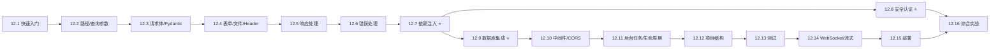

# 12-FastAPI

> 用 FastAPI 构建现代 Python Web API：从第一个接口，到数据库、认证、测试、部署，最后完成一个完整的博客 API 项目。

本章所有示例均在以下环境中实际运行验证：

| 组件 | 版本 |
|---|---|
| Python | 3.14（要求 ≥ 3.10，建议 ≥ 3.11） |
| FastAPI | 0.143 |
| Pydantic | 2.14 |
| Starlette | 1.8 |
| Uvicorn | 0.54 |
| SQLAlchemy | 2.1 |

---

## 📑 目录

- [0. FastAPI 是什么](#0-fastapi-是什么)
- [1. 前置知识](#1-前置知识)
- [2. 环境准备](#2-环境准备)
- [3. 学习大纲](#3-学习大纲)
- [4. 各小节知识点详解](#4-各小节知识点详解)
- [5. 学习路线与时间安排](#5-学习路线与时间安排)
- [6. 核心概念速查](#6-核心概念速查)
- [7. 学习检查清单](#7-学习检查清单)
- [8. 推荐资源](#8-推荐资源)

---

## 0. FastAPI 是什么

**FastAPI** 是一个基于 Python 类型提示构建 API 的现代 Web 框架。它本身很薄，站在两个库的肩膀上：

```text
            ┌────────────────────────────────────────┐
            │                FastAPI                 │
            │  路由声明 · 依赖注入 · OpenAPI 文档生成   │
            └───────────────┬────────────┬───────────┘
                            │            │
              ┌─────────────▼──┐    ┌────▼─────────────┐
              │   Starlette    │    │     Pydantic     │
              │ ASGI / 路由 /   │    │ 数据校验 / 序列化 │
              │ 中间件 / WS     │    │ / JSON Schema    │
              └───────┬────────┘    └──────────────────┘
                      │ ASGI 协议
              ┌───────▼────────┐
              │    Uvicorn     │   ← ASGI 服务器，真正监听端口
              └────────────────┘
```

**核心卖点：**

1. **类型提示即接口契约**：参数写成 `item_id: int`，FastAPI 就自动完成类型转换、校验、错误响应和文档生成。
2. **自动交互式文档**：启动后访问 `/docs`（Swagger UI）和 `/redoc` 就能看到并调试所有接口。
3. **原生异步**：基于 ASGI，`async def` 端点可以高并发处理 I/O 密集型请求。
4. **依赖注入系统**：数据库会话、当前用户、权限校验等都可以用 `Depends` 优雅地复用和替换。
5. **编辑器友好**：全程类型提示，补全和静态检查效果极好。

**和其他框架对比：**

| | FastAPI | Flask | Django (+DRF) |
|---|---|---|---|
| 定位 | API 优先 | 微框架，通用 | 全家桶，含 ORM/后台 |
| 协议 | ASGI（异步原生） | WSGI（同步为主） | WSGI / ASGI |
| 参数校验 | 类型提示 + Pydantic，自动 | 手写或用扩展 | Serializer |
| API 文档 | 自动生成 OpenAPI | 需扩展 | 需扩展 |
| ORM | 不内置，自由选择 | 不内置 | 内置 Django ORM |
| 适合 | 后端 API、微服务、AI 推理服务 | 小型应用、原型 | 内容型网站、带后台的业务系统 |

---

## 1. 前置知识

FastAPI 大量使用了前面章节学过的 Python 特性，开始前建议确认以下内容已掌握：

| 前置知识 | 在 FastAPI 中的用途 | 对应章节 |
|---|---|---|
| 函数参数、默认值 | 路径/查询参数声明 | [3.2 参数详解](../03-函数/3.2-参数详解/) |
| 装饰器 | `@app.get(...)` 注册路由 | [3.7 装饰器](../03-函数/3.7-装饰器/) |
| 类与继承 | Pydantic 模型、输入/输出模型继承 | [04-面向对象](../04-面向对象/) |
| 上下文管理器 | `lifespan`、`yield` 依赖 | [8.4 上下文管理器](../08-高级特性/8.4-上下文管理器/) |
| 生成器 | `yield` 依赖、流式响应 | [8.2 生成器](../08-高级特性/8.2-生成器/) |
| async / await | 异步端点、异步数据库 | [8.8 异步编程](../08-高级特性/8.8-异步编程/) |
| 类型提示 | **整个框架的基础** | [10.1 类型提示](../10-Python进阶/10.1-类型提示/) |
| 枚举 | 限定参数取值 | [10.3 枚举](../10-Python进阶/10.3-枚举/) |
| pytest | 接口测试 | [10.6 测试](../10-Python进阶/10.6-测试/) |
| HTTP 基础 | 方法、状态码、请求头、请求体 | [10.9 网络请求](../10-Python进阶/10.9-网络请求/) |

> 💡 **最重要的一条**：一定要熟悉 `Annotated`、`X | None`、`list[int]` 这类类型注解写法，FastAPI 的一切都建立在它们之上。

---

## 2. 环境准备

### 2.1 使用 uv（推荐）

```bash
# 新建一个练习项目
uv init fastapi-playground
cd fastapi-playground

# 安装 FastAPI 及其推荐的全套依赖（uvicorn、fastapi-cli、httpx、python-multipart、email-validator 等）
uv add "fastapi[standard]"

# 后续章节会用到的依赖，用到时再装也可以
uv add sqlalchemy pydantic-settings pyjwt "pwdlib[argon2]"
uv add --dev pytest
```

### 2.2 使用 pip

```bash
python3 -m venv .venv
source .venv/bin/activate          # Windows: .venv\Scripts\activate
pip install "fastapi[standard]"
```

### 2.3 验证安装

新建 `main.py`：

```python
from fastapi import FastAPI

app = FastAPI()


@app.get("/")
async def root():
    return {"message": "Hello FastAPI"}
```

运行：

```bash
fastapi dev main.py          # 开发模式，自动重载
# 或
uvicorn main:app --reload
```

访问：

- http://127.0.0.1:8000 → `{"message":"Hello FastAPI"}`
- http://127.0.0.1:8000/docs → Swagger 交互式文档
- http://127.0.0.1:8000/redoc → ReDoc 文档

### 2.4 推荐工具

| 工具 | 用途 |
|---|---|
| VS Code + Python / Pylance 插件 | 类型补全、跳转 |
| `/docs` 页面 | 最方便的接口调试工具 |
| curl / [HTTPie](https://httpie.io/) | 命令行发请求 |
| Postman / Bruno | 图形化接口调试、保存请求集合 |
| DB Browser for SQLite | 查看 SQLite 数据 |

---

## 3. 学习大纲

全章分为 **5 个阶段、16 个小节**。每个小节目录下包含 `用法.md`（详细讲解 + 可运行示例）和 `练习题.md`（概念题、读代码题、编程题、综合实践）。

### 🟢 阶段一：基础入门 —— 能写出接口

- [12.1-快速入门](./12.1-快速入门/) - 安装运行、第一个应用、自动文档、`async def` vs `def`
- [12.2-路径参数与查询参数](./12.2-路径参数与查询参数/) - 类型转换、Enum、`Path`/`Query` 校验、查询参数模型
- [12.3-请求体与Pydantic模型](./12.3-请求体与Pydantic模型/) - `BaseModel`、`Field`、嵌套模型、自定义校验器
- [12.4-表单文件Header与Cookie](./12.4-表单文件Header与Cookie/) - `Form`、`UploadFile`、`Header`、`Cookie`、`Request`

### 🔵 阶段二：核心机制 —— 写好接口

- [12.5-响应处理](./12.5-响应处理/) - `response_model`、输入/输出模型分离、状态码、各类 `Response`
- [12.6-错误处理](./12.6-错误处理/) - `HTTPException`、自定义异常处理器、统一错误格式
- [12.7-依赖注入](./12.7-依赖注入/) - `Depends`、类依赖、子依赖、`yield` 依赖、全局依赖 ⭐
- [12.8-安全认证](./12.8-安全认证/) - OAuth2 密码流、JWT、密码哈希、角色权限 ⭐

### 🟣 阶段三：工程能力 —— 接入真实世界

- [12.9-数据库集成](./12.9-数据库集成/) - SQLAlchemy 2.x、Session 依赖、CRUD、关系、异步数据库、Alembic ⭐
- [12.10-中间件与CORS](./12.10-中间件与CORS/) - 洋葱模型、自定义中间件、CORS 原理与配置
- [12.11-后台任务与生命周期](./12.11-后台任务与生命周期/) - `BackgroundTasks`、`lifespan`、任务队列选型

### 🟠 阶段四：项目化 —— 写出可维护的服务

- [12.12-大型项目结构](./12.12-大型项目结构/) - `APIRouter`、目录结构、`pydantic-settings` 配置、分层架构
- [12.13-测试](./12.13-测试/) - `TestClient`、`dependency_overrides`、测试数据库、异步测试
- [12.14-WebSocket与流式响应](./12.14-WebSocket与流式响应/) - WebSocket、聊天室广播、`StreamingResponse`、SSE
- [12.15-部署与性能](./12.15-部署与性能/) - Uvicorn/Gunicorn、Docker、Nginx、阻塞陷阱、性能优化

### 🔴 阶段五：综合实战

- [12.16-综合实战](./12.16-综合实战/) - 从零完成一个带认证、数据库、测试的**博客 API**（含完整可运行代码 `blog-api/`）

---

## 4. 各小节知识点详解

### 12.1 快速入门

- [ ] 安装：`fastapi[standard]` 包含哪些东西
- [ ] 最小应用：`FastAPI()` 实例、路径操作装饰器 `@app.get/post/put/patch/delete`
- [ ] 运行：`fastapi dev` / `fastapi run` / `uvicorn main:app --reload` 的区别
- [ ] 自动文档：`/docs`、`/redoc`、`/openapi.json`
- [ ] 返回值：dict、list、Pydantic 模型如何被自动转为 JSON
- [ ] `async def` 与 `def`：什么时候用哪个，`def` 端点会在线程池中运行
- [ ] FastAPI = Starlette + Pydantic 的整体架构

### 12.2 路径参数与查询参数

- [ ] 路径参数 `/items/{item_id}` 与类型自动转换
- [ ] 用 `Enum` 限定路径参数取值
- [ ] 路由声明顺序问题（`/users/me` 必须在 `/users/{user_id}` 之前）
- [ ] `{file_path:path}` 匹配包含 `/` 的路径
- [ ] 查询参数：必填、可选、默认值、`bool` 的宽松转换
- [ ] `Annotated[str, Query(min_length=3, pattern=...)]` 字符串校验
- [ ] `Annotated[int, Path(ge=1)]` 数值校验
- [ ] 列表查询参数 `?tag=a&tag=b`、别名 `alias`、`deprecated`
- [ ] 用 Pydantic 模型声明一组查询参数
- [ ] 读懂 422 校验错误的响应结构

### 12.3 请求体与 Pydantic 模型

- [ ] `BaseModel` 声明 JSON 请求体
- [ ] `Field` 约束：长度、范围、正则、默认值、描述、示例
- [ ] 嵌套模型、`list[Model]`、`dict[str, int]`
- [ ] 特殊类型：`EmailStr`、`HttpUrl`、`datetime`、`UUID`、`Decimal`
- [ ] `@field_validator` / `@model_validator` 自定义校验
- [ ] `ConfigDict`：`extra="forbid"`、`str_strip_whitespace` 等
- [ ] 路径参数 + 查询参数 + 请求体混合时的识别规则
- [ ] 多个请求体、`Body(embed=True)`
- [ ] `model_dump(exclude_unset=True)` 实现 PATCH 部分更新

### 12.4 表单、文件、Header 与 Cookie

- [ ] `Form` 接收表单数据（依赖 `python-multipart`）
- [ ] `bytes` vs `UploadFile`：小文件与大文件的处理方式
- [ ] `UploadFile` 的属性（`filename`、`content_type`、`size`）与异步方法
- [ ] 多文件上传、文件 + 表单字段混合
- [ ] `Header`：下划线自动转连字符、重复请求头
- [ ] `Cookie` 读取
- [ ] 直接使用 `Request` 对象的场景

### 12.5 响应处理

- [ ] `response_model` 与返回类型注解：过滤敏感字段（如密码）
- [ ] 输入/输出/数据库模型分离：`UserIn` / `UserOut` / `UserInDB`
- [ ] `response_model_exclude_unset` / `exclude_none`
- [ ] `status_code=201` 与 `fastapi.status` 常量
- [ ] `JSONResponse`、`HTMLResponse`、`PlainTextResponse`、`RedirectResponse`、`FileResponse`、`StreamingResponse`
- [ ] 设置响应头和 Cookie
- [ ] `jsonable_encoder` 的作用
- [ ] `responses=` 为文档声明额外的响应

### 12.6 错误处理

- [ ] `raise HTTPException(status_code=404, detail=...)`
- [ ] 自定义业务异常类 + `@app.exception_handler`
- [ ] 覆盖默认的 `RequestValidationError`（422）处理器
- [ ] 覆盖默认的 `HTTPException` 处理器
- [ ] 设计统一错误响应格式 `{"code": ..., "message": ..., "details": ...}`
- [ ] 兜底处理未捕获异常（500），避免泄露堆栈

### 12.7 依赖注入 ⭐

- [ ] 为什么需要依赖注入：复用、解耦、可测试
- [ ] 函数依赖：公共分页参数
- [ ] `Annotated` 依赖别名：`SessionDep = Annotated[Session, Depends(get_session)]`
- [ ] 类作为依赖
- [ ] 子依赖、依赖树、同一请求内的依赖缓存
- [ ] `yield` 依赖：获取资源 → 使用 → 释放（数据库会话的标准写法）
- [ ] 路径装饰器依赖、路由器依赖、全局依赖
- [ ] 可参数化依赖（带 `__call__` 的类）

### 12.8 安全认证 ⭐

- [ ] 认证（你是谁）vs 授权（你能做什么）
- [ ] HTTP Basic、API Key
- [ ] OAuth2 密码流：`OAuth2PasswordBearer` + `OAuth2PasswordRequestForm`
- [ ] 密码哈希：`pwdlib`（Argon2）
- [ ] JWT：签发、校验、过期处理（PyJWT）
- [ ] `get_current_user` 依赖链
- [ ] 基于角色的权限控制、OAuth2 scopes 简介
- [ ] 安全最佳实践

### 12.9 数据库集成 ⭐

- [ ] SQLAlchemy 2.x 声明式模型：`DeclarativeBase`、`Mapped`、`mapped_column`
- [ ] engine、sessionmaker 与 `yield` Session 依赖
- [ ] ORM 模型与 Pydantic Schema 分离、`from_attributes=True`
- [ ] 完整 CRUD + 分页 + 404 + 唯一约束冲突（409）
- [ ] 一对多关系与 N+1 问题（`selectinload`）
- [ ] 异步数据库：`AsyncSession` + `aiosqlite`
- [ ] SQLModel 简介
- [ ] Alembic 数据库迁移入门

### 12.10 中间件与 CORS

- [ ] 中间件的洋葱模型与执行顺序
- [ ] `@app.middleware("http")`：计时、请求 ID、日志
- [ ] `BaseHTTPMiddleware` 与纯 ASGI 中间件
- [ ] 同源策略、简单请求与预检请求
- [ ] `CORSMiddleware` 各参数含义
- [ ] `GZipMiddleware`、`TrustedHostMiddleware`
- [ ] 中间件 vs 依赖 vs 异常处理器：如何选择

### 12.11 后台任务与生命周期

- [ ] `BackgroundTasks`：响应返回后再执行的任务（发邮件、写日志）
- [ ] `lifespan`：应用启动/关闭时的资源初始化与清理
- [ ] `app.state` / `request.state` 共享资源
- [ ] 在异步代码中运行阻塞函数：`run_in_threadpool`
- [ ] 何时需要 Celery / ARQ 等任务队列

### 12.12 大型项目结构

- [ ] `APIRouter` 拆分路由：`prefix`、`tags`、`dependencies`
- [ ] 按层 vs 按功能模块的目录结构
- [ ] `pydantic-settings` 管理配置与 `.env`
- [ ] API 版本化 `/api/v1`
- [ ] `app.mount` 挂载静态文件与子应用
- [ ] OpenAPI 文档元数据定制
- [ ] router → service → repository 分层架构

### 12.13 测试

- [ ] `TestClient` 发送各类请求
- [ ] pytest fixture 与 `conftest.py` 组织
- [ ] `app.dependency_overrides` 替换数据库、当前用户
- [ ] SQLite 内存库 + `StaticPool` 的测试数据库方案
- [ ] 测试中触发 `lifespan`
- [ ] 异步测试：`httpx.AsyncClient` + `ASGITransport`
- [ ] 测试 WebSocket、测试覆盖率

### 12.14 WebSocket 与流式响应

- [ ] WebSocket 基本收发与断开处理
- [ ] WebSocket 中的参数、依赖与鉴权
- [ ] `ConnectionManager` 实现聊天室广播
- [ ] `StreamingResponse`：大文件、逐字输出（LLM 场景）
- [ ] SSE（Server-Sent Events）
- [ ] WebSocket vs SSE vs 轮询的选择

### 12.15 部署与性能

- [ ] `fastapi run` / Uvicorn 生产参数、多 worker
- [ ] Gunicorn + Uvicorn worker
- [ ] Dockerfile 最佳实践、Docker Compose
- [ ] Nginx 反向代理、`root_path`、代理头
- [ ] 日志、健康检查
- [ ] 在 `async def` 中调用阻塞代码的危害
- [ ] 连接池、缓存、限流、压测
- [ ] 生产环境检查清单

### 12.16 综合实战：博客 API

- [ ] 需求分析与目录结构设计
- [ ] 用户注册 / 登录（JWT）
- [ ] 文章 CRUD、分页搜索、作者权限
- [ ] 评论（一对多关系）
- [ ] 统一异常、中间件、CORS、lifespan
- [ ] 完整测试套件
- [ ] 扩展任务：点赞、刷新 token、Alembic、Docker 化……

---

## 5. 学习路线与时间安排



| 阶段 | 小节 | 建议用时 | 阶段目标 |
|---|---|---|---|
| 一、基础入门 | 12.1 – 12.4 | 3 – 4 天 | 能写出接收各类参数、带校验的接口 |
| 二、核心机制 | 12.5 – 12.8 | 5 – 7 天 | 掌握响应控制、错误处理、**依赖注入**、JWT 认证 |
| 三、工程能力 | 12.9 – 12.11 | 4 – 5 天 | 能接入数据库，理解中间件与应用生命周期 |
| 四、项目化 | 12.12 – 12.15 | 5 – 7 天 | 能组织多文件项目、写测试、完成部署 |
| 五、综合实战 | 12.16 | 5 – 7 天 | 独立完成并扩展一个完整项目 |

**学习方法建议：**

1. **每节都开着 `/docs` 学**：写完一个接口立刻在 Swagger UI 里点 "Try it out"，观察请求和响应。
2. **故意传错参数**：看 422 错误长什么样，比只看成功响应学得更快。
3. **重点吃透 12.7 依赖注入**：它是 FastAPI 的灵魂，认证、数据库、测试都建立在它之上。
4. **从 12.9 开始坚持写测试**：用 12.13 的方法给自己写的接口补测试。
5. **最后读 12.16 的完整代码**：对照映射表回顾每个知识点在真实项目里的样子。

---

## 6. 核心概念速查

### 参数来源识别规则

FastAPI 根据参数的**声明方式**决定从请求的哪个位置取值：

| 声明方式 | 取值位置 | 示例 |
|---|---|---|
| 参数名出现在路径 `{}` 中 | 路径参数 | `def f(item_id: int)` + `"/items/{item_id}"` |
| 简单类型（int/str/bool…），不在路径中 | 查询参数 | `def f(q: str \| None = None)` |
| Pydantic 模型 | JSON 请求体 | `def f(item: Item)` |
| `Annotated[..., Query()]` / `Path()` / `Body()` | 显式指定 | `q: Annotated[str, Query(max_length=50)]` |
| `Annotated[..., Header()]` / `Cookie()` | 请求头 / Cookie | `user_agent: Annotated[str, Header()]` |
| `Annotated[..., Form()]` / `File()` | 表单 / 文件 | `file: UploadFile` |
| `Annotated[..., Depends(fn)]` | 依赖函数的返回值 | `db: Annotated[Session, Depends(get_db)]` |
| `Request` / `Response` / `BackgroundTasks` 类型 | 框架直接注入 | `request: Request` |

### 一个请求的处理流程

```text
客户端请求
   │
   ▼
Uvicorn（ASGI 服务器）
   │
   ▼
中间件（外 → 内）  ← CORS、GZip、计时、请求 ID …
   │
   ▼
路由匹配（找到对应的路径操作函数）
   │
   ▼
解析依赖树 + 提取并校验参数（Pydantic）──失败──▶ 422 RequestValidationError
   │
   ▼
执行路径操作函数 ──raise HTTPException / 自定义异常──▶ 异常处理器
   │
   ▼
按 response_model 过滤、校验、序列化返回值
   │
   ▼
yield 依赖的清理代码、BackgroundTasks
   │
   ▼
中间件（内 → 外）
   │
   ▼
响应返回客户端
```

### 常用导入速查

```python
from typing import Annotated

from fastapi import (
    FastAPI, APIRouter,                          # 应用与路由
    Path, Query, Body, Header, Cookie,           # 参数声明
    Form, File, UploadFile,                      # 表单与文件
    Depends, Security,                           # 依赖注入
    HTTPException, status,                       # 错误与状态码
    Request, Response, BackgroundTasks,          # 框架对象
    WebSocket, WebSocketDisconnect,              # WebSocket
)
from fastapi.responses import (
    JSONResponse, HTMLResponse, PlainTextResponse,
    RedirectResponse, FileResponse, StreamingResponse,
)
from fastapi.security import OAuth2PasswordBearer, OAuth2PasswordRequestForm
from fastapi.middleware.cors import CORSMiddleware
from fastapi.testclient import TestClient
from pydantic import BaseModel, Field, ConfigDict, field_validator
```

### 状态码速查

| 状态码 | 常量 | 典型场景 |
|---|---|---|
| 200 | `HTTP_200_OK` | 查询成功、更新成功 |
| 201 | `HTTP_201_CREATED` | 创建资源成功 |
| 204 | `HTTP_204_NO_CONTENT` | 删除成功，无响应体 |
| 400 | `HTTP_400_BAD_REQUEST` | 业务上的请求错误 |
| 401 | `HTTP_401_UNAUTHORIZED` | 未登录 / token 无效 |
| 403 | `HTTP_403_FORBIDDEN` | 已登录但无权限 |
| 404 | `HTTP_404_NOT_FOUND` | 资源不存在 |
| 409 | `HTTP_409_CONFLICT` | 资源冲突（如用户名已存在） |
| 422 | `HTTP_422_UNPROCESSABLE_CONTENT` | 参数校验失败（FastAPI 自动返回） |
| 429 | `HTTP_429_TOO_MANY_REQUESTS` | 触发限流 |
| 500 | `HTTP_500_INTERNAL_SERVER_ERROR` | 服务器内部错误 |

### ⚠️ 新版本差异提示

网上很多教程基于较老的 FastAPI / Starlette / Pydantic 版本。以下是编写本章时实测发现、与旧教程**不一致**的地方（各小节正文中均有详细说明）：

| 主题 | 旧教程常见说法 | 当前版本实际行为 | 详见 |
|---|---|---|---|
| 422 状态码常量 | `HTTP_422_UNPROCESSABLE_ENTITY` | 改名为 `HTTP_422_UNPROCESSABLE_CONTENT`，旧名会告警 | 12.5 |
| 422 错误体 | 含 `url` 字段 | 只有 `type`/`loc`/`msg`/`input`/`ctx` | 12.2 |
| 启动/关闭事件 | `@app.on_event("startup")` | 已废弃；传了 `lifespan` 后 `on_event` 会被静默忽略 | 12.11 |
| `yield` 依赖退出时机 | 响应返回前清理 | 默认在**响应发出后**才退出；需要提前退出用 `Depends(..., scope="function")` | 12.7 |
| 密码哈希 | `passlib` | 官方改用 `pwdlib`（Argon2） | 12.8 |
| `APIKeyHeader`/`HTTPBearer` 缺凭证 | 返回 403 | 返回 401 并带 `WWW-Authenticate` | 12.8 |
| `TestClient` | 基于 `httpx` | Starlette 1.x 推荐安装 `httpx2`，否则有弃用告警 | 12.13 |
| 异步 SQLAlchemy | `pip install sqlalchemy` 即可 | 需 `sqlalchemy[asyncio]`（带 greenlet） | 12.9 |
| SSE | 需第三方 `sse-starlette` | 内置 `fastapi.sse.EventSourceResponse` | 12.14 |
| Gunicorn worker | `uvicorn.workers.UvicornWorker` | 已弃用，改用 `uvicorn-worker` 包 | 12.15 |
| JSON 性能 | 用 `ORJSONResponse` 提速 | 已弃用；声明返回类型即走 Pydantic 快速序列化 | 12.15 |
| Pydantic 别名 | `populate_by_name=True` | 推荐 `validate_by_name=True` | 12.3 |

---

## 7. 学习检查清单

完成本章后，你应该能够：

- [ ] 解释 FastAPI、Starlette、Pydantic、Uvicorn 各自的职责
- [ ] 根据场景正确选择 `async def` 或 `def` 定义端点
- [ ] 声明带完整校验规则的路径参数、查询参数和请求体
- [ ] 用输入/输出模型分离防止敏感字段泄露
- [ ] 设计并实现统一的错误响应格式
- [ ] 用依赖注入实现数据库会话、分页、当前用户、权限校验
- [ ] 实现基于 JWT 的注册、登录、鉴权流程
- [ ] 用 SQLAlchemy 2.x 完成带关系的 CRUD，并避免 N+1 查询
- [ ] 编写中间件，正确配置 CORS
- [ ] 用 `lifespan` 管理应用级资源
- [ ] 把单文件应用拆分为结构清晰的多模块项目
- [ ] 用 `TestClient` + `dependency_overrides` 写出隔离的接口测试
- [ ] 实现 WebSocket 广播和流式响应
- [ ] 用 Docker 部署 FastAPI 应用，并说出常见性能陷阱
- [ ] 独立完成并扩展 12.16 的博客 API 项目

---

## 8. 推荐资源

- [FastAPI 官方文档](https://fastapi.tiangolo.com/zh/)（有中文版，教程部分质量很高）
- [Pydantic 官方文档](https://docs.pydantic.dev/)
- [Starlette 官方文档](https://www.starlette.io/)
- [SQLAlchemy 2.0 教程](https://docs.sqlalchemy.org/en/20/tutorial/)
- [Full Stack FastAPI Template](https://github.com/fastapi/full-stack-fastapi-template)（官方全栈项目模板，适合学完后参考）
